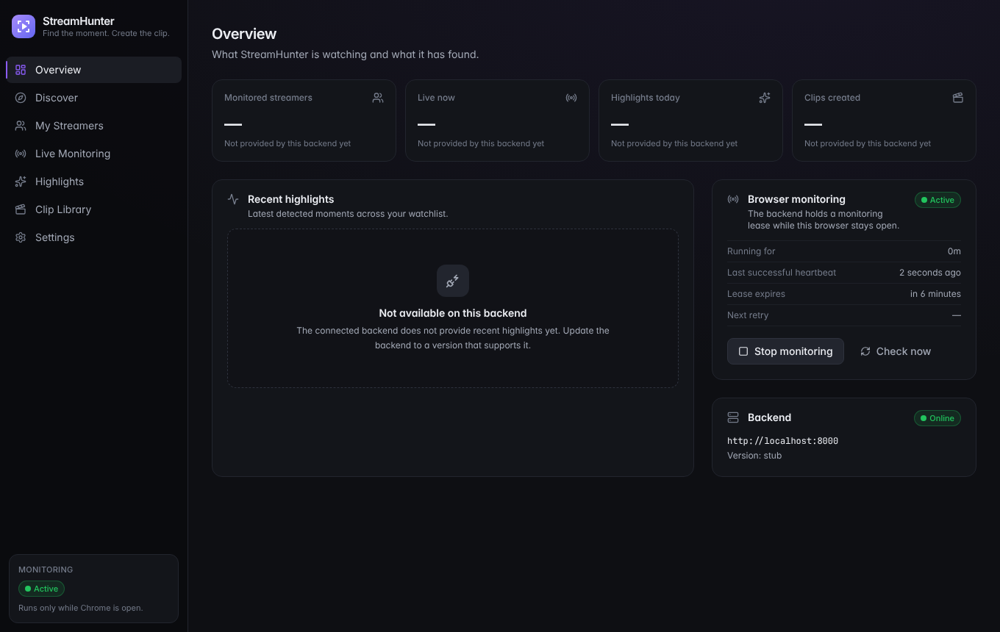

# StreamHunter

**Find the moment. Create the clip.**

StreamHunter is a Chrome extension for video editors and clipping teams. It watches
Twitch and Kick streamers while your browser is open, reads chat to spot moments
when the audience reacts, explains *why* each moment was flagged, and helps you turn
it into a clip. Nothing is ever published without your approval.

> **Status:** Phase 1 (extension foundation) is complete. The backend, platform
> integrations and detection come next. See [IMPLEMENTATION_STATUS.md](IMPLEMENTATION_STATUS.md).



## Features

| | Status |
|---|---|
| MV3 extension: popup, full-page workspace, side panel | ✅ |
| Settings (monitoring interval, sensitivity, score threshold, languages, clip defaults, notifications, time zone, retention) | ✅ |
| Browser-based monitoring control with heartbeat, backoff and restart recovery | ✅ (extension side) |
| Streamer search & watchlist (Twitch + Kick) | ⏳ Phase 3 |
| Chat-based highlight detection with explainable scores | ⏳ Phase 5 |
| Twitch clip creation; Kick manual workflow | ⏳ Phase 6 |

## Technology

* **Extension:** Chrome Manifest V3, React 19, TypeScript (strict), Vite 7, Tailwind CSS 4, Lucide icons
* **Backend (Phase 2+):** Python 3.12+, FastAPI, Pydantic, SQLAlchemy 2, Alembic, SQLite → PostgreSQL, HTTPX, Pytest

## Requirements

* Node.js 20+ and npm 10+
* Google Chrome 116+ (or another Chromium browser)
* Python 3.12+ (for the backend, from Phase 2)

## Install & build the extension

```bash
cd extension
```

```bash
npm ci
```

```bash
npm run build
```

The built extension is written to `extension/dist/`.

### Load it in Chrome

1. Open `chrome://extensions`.
2. Turn on **Developer mode** (top right).
3. Click **Load unpacked** and select `extension/dist`.
4. Pin StreamHunter in the toolbar. The full workspace opens automatically on first install.

### Develop

```bash
npm run dev
```

This rebuilds `dist/` on every change. Click the reload icon on the extension card
in `chrome://extensions` to pick up service worker or manifest changes.

## Tests

```bash
npm test
```

```bash
npm run typecheck
```

The tests use an in-memory fake of the Chrome APIs (`src/test/fake-chrome.ts`). They
cover settings validation, storage persistence, the API client, the monitoring state
machine (backoff, recovery, restore after restart), service worker wiring and
messaging, and rendering of the popup, workspace and side panel.

## Backend & platforms

The backend arrives in Phase 2. The extension expects it at `http://localhost:8000`,
which you can change in **Settings → Backend**. Until it runs, the extension shows
*Backend offline* and never displays made-up data.

Platform setup (Phase 3), summarised:

* **Twitch:** create an app at https://dev.twitch.tv/console/apps, set the redirect
  URI to `http://localhost:8000/api/v1/auth/twitch/callback`, and put the client ID
  and secret in `backend/.env`.
* **Kick:** create an app in Kick's developer settings and set the redirect URI to
  `http://localhost:8000/api/v1/auth/kick/callback`. Chat monitoring additionally
  requires a **public HTTPS webhook URL** (for example a Cloudflare Tunnel), because
  Kick delivers chat only through webhooks.

See [.env.example](.env.example) for all variables.

## Known limitations

* Monitoring runs **only while Chrome is open**. Closing the browser pauses it.
* Kick has **no official clip or VOD API**. Kick clips need a manual step.
* A Twitch clip is a link on Twitch, not a downloadable video file.
* Stream offsets are approximate (they come from the platform's `started_at`).

## Documentation

* [PROJECT_PLAN.md](PROJECT_PLAN.md): phases, risks, decisions
* [ARCHITECTURE.md](ARCHITECTURE.md): system design and verified platform capabilities
* [IMPLEMENTATION_STATUS.md](IMPLEMENTATION_STATUS.md): what works, what is pending
* [SECURITY.md](SECURITY.md): security and privacy policy
